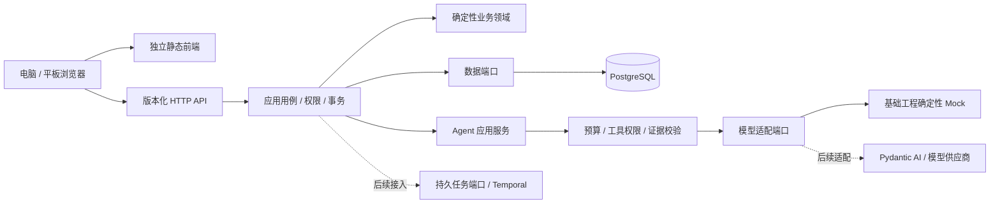

# Hermes 架构定稿：业务核心与 Agent 能力独立演进

决策日期：2026-09-30。用户已确认：云端网站、电脑和平板共享数据、前后端完全分离、全新项目不受旧实现约束。本轮交付基础工程与一个学习会话切片，完整产品范围仍见01和06。此文是新版工程结构的权威决策，替代02中尚未确定的技术候选；性能预算和产品规则继续有效。

## 1. 架构目标与边界

优雅的判断标准是可以检查的：依赖只向内、业务不依赖框架、一个事实只有一个权威来源、接口自动生成、模型与工具能替换、失败可定位、升级可评测和回退。不能承诺某一种技术永远最优，或未来模型无需适配即可自动增强全部产品能力。

采用前后端独立部署的模块化单体。仓库组织在一起便于契约和变更原子提交，运行时完全分离：前端没有业务后端、数据库凭证或模型密钥；API不打包或提供前端页面。



同域反向代理是推荐入口拓扑，不代表前后端耦合。开发时独立端口、前端代理API；部署时静态站与API可以分别扩缩容、发布和回退。跨域部署须额外明确CORS、cookie、CSRF与可信来源，不用开放所有来源解决问题。

## 2. 技术决策

| 层 | 决策 | 边界 |
| --- | --- | --- |
| 前端 | React、TypeScript、Vite | 纯浏览器应用，独立构建产物；本轮不引入服务端渲染 |
| 服务端状态 | TanStack Query | 数据以API为准，本地状态只承担输入和界面，不另建一份业务真相 |
| HTTP契约 | FastAPI OpenAPI → openapi-typescript | 后端schema唯一来源，生成共享TS类型；前端不导入Python源码 |
| API | Python + FastAPI + Pydantic | 输入与输出边界校验，业务领域保持普通Python模型与规则 |
| 数据 | PostgreSQL + SQLAlchemy + Alembic | 显式迁移和事务；SQLite仅本地演示/隔离测试，不能据此宣称Postgres实测通过 |
| 身份 | 服务端会话cookie + Argon2密码哈希 + CSRF | 身份与学习会话不同；生产环境强制安全配置 |
| 模型 | 自有窄接口，基础版Mock | Pydantic AI是后续真实模型适配候选；SDK留在外层，不成为业务的父类 |
| 长任务 | 后续持久工作流适配层 | Temporal作为需要暂停恢复、多步工具与补偿时的选定候选，不把内存后台任务当可靠队列 |
| 工具协议 | 后续MCP适配层 | MCP连接工具，不替代用户授权或业务API；不会默认暴露shell/数据库写工具 |
| 观测 | 请求ID、结构化错误为基础；后续OpenTelemetry | 不记录密码、令牌、私有题目全文；GenAI语义规范版本需固定，不能当成永不变化的标准 |

本次查询注册源稳定版本：React19.3.0、Vite8.3.1、TypeScript7.0.2、TanStack Query5.104.0、Vitest5.0.2、openapi-typescript7.13.0。实际安装结果以各lockfile为准。Python运行时以本轮实测环境记录，不通过“年份最新”代替兼容性和安全验证。

## 3. 目录和依赖方向

```text
hermes-rebuild/
├── apps/
│   ├── web/                 # 独立前端应用、feature组件、API客户端
│   └── api/                 # 独立Python包、迁移、领域/用例/适配器/HTTP
├── packages/contracts/      # 生成的OpenAPI快照与TypeScript类型
├── scripts/                 # 契约生成和漂移检查
├── infra/                   # 独立镜像与本地组合部署
└── 01…09文档                 # 需求、契约、ADR与验证证据
```

后端依赖方向：HTTP适配器→应用用例→领域；应用用例只认识数据/模型端口；ORM与供应商SDK实现端口；composition root组装。领域不得导入FastAPI、SQLAlchemy或模型SDK。应用服务不能使用全局数据库连接或HTTP请求对象。

基础阶段用少量清楚的文件表达层次，不先建立几十个空目录。业务扩展时沿身份、学习、证据、内容、建议、附件、Agent拆垂直模块，模块之间调用公开用例或事件，禁止直接操作别的模块的表。只有部署、团队或吞吐需求证明需要时再提取独立服务。

前端依赖方向：app组装→features→shared。features不能导入API数据库、模型SDK或另一个feature内部文件；共享层不承载页面业务。生成类型是构建依赖，不能手工修改以消除类型错误。

## 4. 模型越来越强时如何演进

稳定部分是用户数据主权、授权、学习事实与证据；变化部分是模型、工具、上下文整理与规划策略。

1. **能力声明**：每个适配器声明输入模态、结构化输出、工具范围、流式与取消支持。新模型没有声明图片能力时不送图片；不以“OpenAI兼容”推定全部能力。
2. **版本化运行配置**：后续AgentRun记录模型标识、提示版本、工具schema版本、证据ID/版本、策略版本和预算。版本变动可复现、比较与回退，不依赖一个不可解释的长对话对象。
3. **读与写分离**：模型读取限定证据，输出facts/inferences/missing_information。建议不是业务事实；写入学习事实仍由确定性用例校验，未来开放工具写入时必须有显式操作、幂等和授权。
4. **能力渐进开放**：先解释→用户确认的建议→可恢复多步分析→受限工具调用。换更强模型不自动扩大工具权限；工具返回的文字也不拥有系统指令权。
5. **质量门禁**：固定样例、无证据、错误引用、跨用户、预算耗尽、取消与供应商失败。模型升级先离线评测，再影子比较和小范围上线；有质量下降即可回退。

持久执行需要保存运行状态，不把断线等同完成。工作流重放必须确定性；模型与外部工具调用放在可记录的活动里；外部副作用另有幂等键与补偿。基础Mock接口不宣称已经实现持久Agent编排、真实多模型路由或多Agent自动协作。

## 5. 业务一致性

服务端拥有学习事实。每账号active/paused合计最多一个未结束会话；资源版本避免两设备静默覆盖；操作幂等避免重试重复写入。会话保存开始时区和开始学习日，晚到核对不改写归属。未来反馈仍遵守未核对不能计入正确或掌握证据。

PostgreSQL是目标生产数据源。迁移与业务事务有独立生命周期；应用启动不自动对生产表create_all。后续投影、事件或检索索引都可由事实重建，不能变成第二份权威数据库。需要跨事务任务时引入事务outbox与可恢复worker，再由指标决定是否接消息总线。

## 6. 安全、观测与部署

密码不在Git、前端或日志。cookie仅持有不透明服务端会话标识；写请求同时验证身份、CSRF和资源归属。生产配置拒绝SQLite与不安全cookie等演示模式。公开健康接口不返回数据库地址、异常堆栈或私有账户信息。

镜像与部署分开：前端构建静态资源；API构建Python包；迁移是显式一次性步骤；数据库仅内部网络。基础compose只用于本地集成，不能直接当作完成TLS、备份、告警和安全审计的生产配置。

基础工程用request_id关联问题。后续OpenTelemetry trace贯穿HTTP→用例→数据库→模型/工具，记录耗时、调用数、token/预算与错误类别；默认不采集题目/提示全文，必要诊断需独立授权与保留周期。

## 7. 迁移、风险和回退

这是全新工程，旧代码、旧数据及旧路由不迁移、不删除。新数据库仅运行显式初始化迁移，本轮合成演示账号与隔离测试库不是生产数据。若未来迁移真实数据，依05流程重新取得执行授权。

主要风险：类型工具版本兼容、SQLite与Postgres行为差异、跨域cookie配置、模型输出可靠性、工作流复杂度。应对是lockfile、契约漂移检查、生产数据库集成测试、同域入口、证据校验及按需引入durable runtime。

基础工程可通过Git提交回退；API契约保持/api/v1且只覆盖已实现切片。后续数据库迁移先扩展兼容字段，再发布读写，再清理旧结构；真实数据禁止靠回滚文件直接删除。模型回退通过适配器和运行配置版本，不修改业务历史。

## 8. 官方资料与证据限度

以下资料已于2026-09-30核查；工程选择是本项目判断，不是官方对“最佳架构”的排名。

- [React版本](https://react.dev/versions)与[Vite发布](https://vite.dev/blog)。
- [TanStack Query](https://tanstack.com/query/latest/docs/framework/react/overview)与[OpenAPI TypeScript](https://openapi-ts.dev/introduction)。
- [FastAPI发布说明](https://fastapi.tiangolo.com/release-notes/)。
- [Pydantic AI](https://ai.pydantic.dev/)及[持久执行](https://ai.pydantic.dev/durable_execution/)。
- [Temporal工作流](https://docs.temporal.io/workflow-execution)、[MCP版本协商](https://modelcontextprotocol.io/specification/versioning)、[OpenTelemetry GenAI语义约定](https://opentelemetry.io/docs/specs/semconv/gen-ai/)。

“架构定稿”指工程边界和本轮方案已选定；完整产品、生产部署、性能预算与未来模型能力仍须分别实现并验证。
